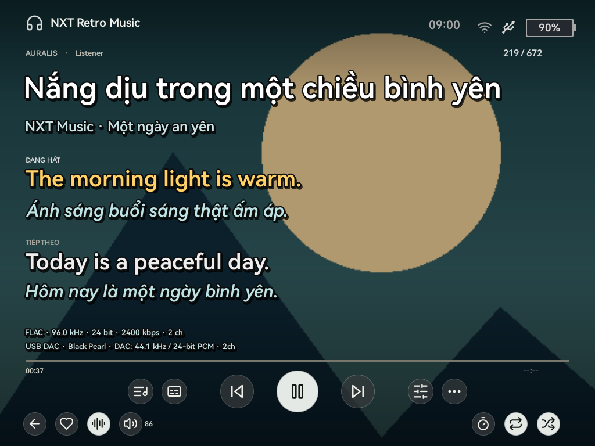
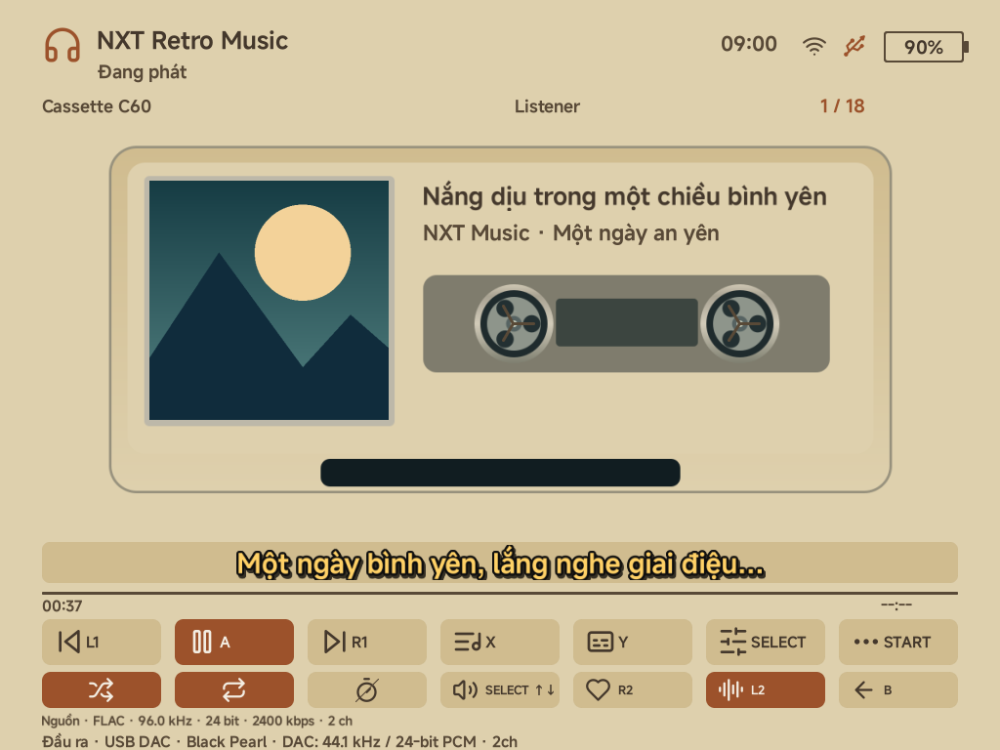
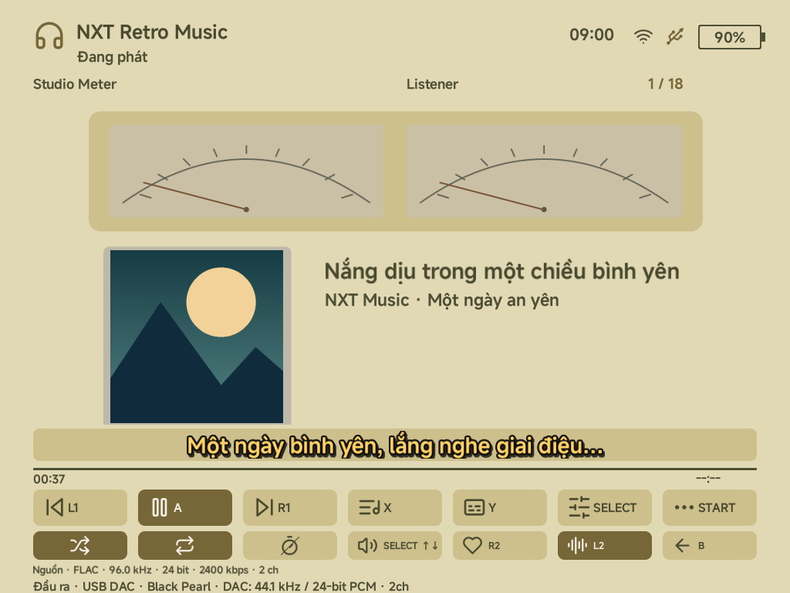
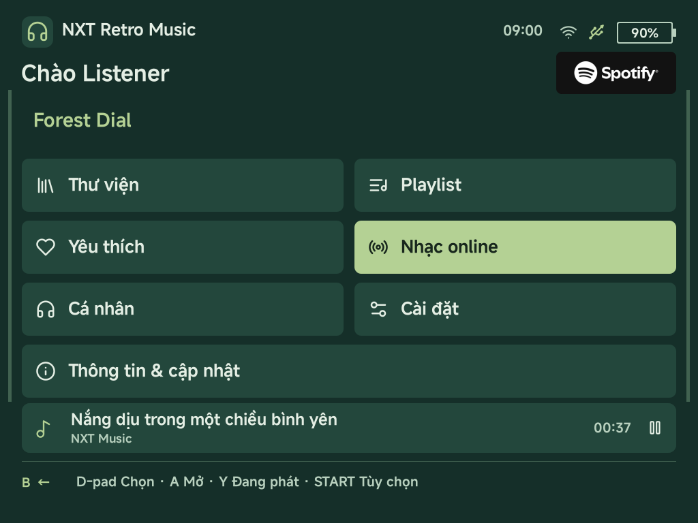
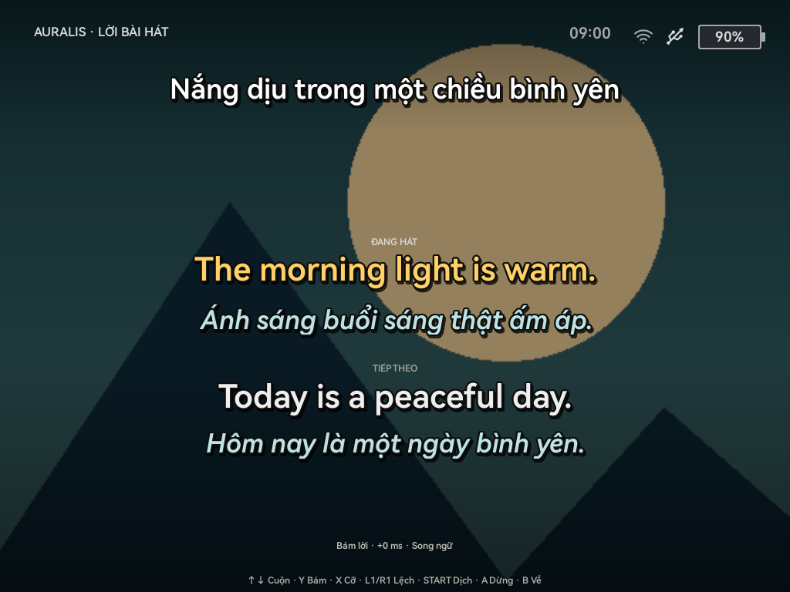

# NXT Retro Music

**A music player for TrimUI Brick, Brick Hammer, and Brick Pro, running on NX Redux and NextUI, with a separate Stock ROM package for Brick Pro.**

**Built through vibe coding.**

[English](README.md) · [Tiếng Việt](README.vi.md)

NXT Retro Music brings local music, online sources, USB DAC playback, bilingual lyrics and extensive personalization together on a retro handheld. Choose a listening profile, pick a theme and make the player feel like your own.

**Idea and implementation:** Nguyễn Xuân Thông — **Spring Thông**. This is a personal, AI-assisted **vibe coding** project, developed through repeated implementation, device testing and feedback. It builds on existing open-source player and firmware projects; credits and license notices are retained below.

This README describes **v1.9.7.7**, with separate packages for **Stock, NextUI and NX Redux**.

## Info

- **Author:** Nguyễn Xuân Thông — **Spring Thông**
- **Hardware family:** TrimUI Brick · Brick Hammer · Brick Pro
- **Firmware packages:** Stock · NextUI · NX Redux
- **Version:** **1.9.7.7**
- **Validation:** Tested by the author on Brick Pro. Brick and Brick Hammer require device/firmware confirmation; controls, LED and DAC behavior can differ.

[Download releases](https://github.com/SpringThong/NXT-Retro-Music-Source/releases) · [Report an issue](https://github.com/SpringThong/NXT-Retro-Music-Source/issues/new)



*Native UI render using sample artwork and lyrics. Images show the Vietnamese interface; these are rendered previews, not photographs of a device.*

## Contents

- [At a glance](#at-a-glance)
- [Compatibility and installation](#compatibility-and-installation)
- [Playback, library and playlists](#playback-library-and-playlists)
- [Audio, DAC and DSD](#audio-dac-and-dsd)
- [Lyrics, translation and word highlighting](#lyrics-translation-and-word-highlighting)
- [Make it yours](#make-it-yours)
- [Profiles, recommendations and statistics](#profiles-recommendations-and-statistics)
- [Default controls](#default-controls)
- [Online source setup](#online-source-setup)
- [Power, performance and screen-off controls](#power-performance-and-screen-off-controls)
- [Wi-Fi file transfer](#wi-fi-file-transfer)
- [OTA updates](#ota-updates)
- [Build from source](#build-from-source)
- [Troubleshooting and feedback](#troubleshooting-and-feedback)
- [Credits and licenses](#credits-and-licenses)
- [Support the project](#support-the-project)

## At a glance

| Area | What you can do |
| --- | --- |
| Music | Play files from the SD card; browse tracks, folders, artists and albums; manage queues, favorites and playlists. |
| Online | Use Spotify Premium, public SoundCloud tracks/playlists, public Google Drive audio/folders, internet radio and podcasts. |
| Sound | Switch between speakers, 3.5 mm, Bluetooth and USB DAC; use Normal, Bit-Perfect or Automatic sound modes. |
| DSD | Play local DSF/DFF through a compatible USB DAC using Native DSD, DoP or automatic Native/DoP selection. |
| EQ/DSP | 12 quick presets, custom graphic EQ, advanced 10/15/31-band options, six parametric filters and saved presets. |
| Lyrics | Compact and full-screen lyrics, bilingual display, italic translations, word highlighting and optional Groq voice-timing analysis. |
| Personalization | **51 themes, 60 fonts, 300 selectable icons, 180 3D emoji**, wallpapers, RGB/HEX colors and live appearance previews. |
| Lighting | Music spectrum palettes/styles and reactive LED colors/effects with immediate setting changes. |
| Profiles | Up to 16 local listeners, separate appearance/history, listening statistics and preference-based suggestions. |
| Convenience | Restore the previous song/position, background playback, sleep-and-exit timer, screen-off controls, Wi-Fi file transfer and ROM-specific OTA. |
| Languages | 14 app languages, language-aware on-screen keyboards and offline multilingual font fallback. |

### More of the interface

| Cassette C60 | Studio Meter |
| --- | --- |
|  |  |

| Forest Dial menu | Auralis full-screen lyrics |
| --- | --- |
|  |  |

## Compatibility and installation

The current target is **TrimUI Brick Pro**. Select the package matching the installed ROM; the three packages share the project source but use different launch paths and ROM adapters.

| ROM | Installer | App folder on the SD card |
| --- | --- | --- |
| Stock | `NXT_Retro_Music_v1.9.7.7_Stock.zip` | `Apps/NXT_Retro_Music/` |
| NextUI | `NXT_Retro_Music_v1.9.7.7_NextUI.zip` | `Tools/tg5040/NXT Retro Music.pak/` |
| NX Redux | `NXT_Retro_Music_v1.9.7.7_NXRedux.zip` | `Tools/NXT Retro Music.pak/` |

1. Download the matching installer from the project's release downloads. The `_Source.zip` is for development; `NXT_OTA_Google_Drive_…` packages are publisher kits.
2. Close NXT completely before replacing an existing installation. Back up your app data before a manual update.
3. Extract the installer **to the root of the SD card**, merging the included `Apps` or `Tools` directory. Avoid an extra nested app folder.
4. Launch NXT from your ROM's Apps/Tools menu.
5. Select or create a listener. NXT opens Now Playing with that listener's saved song and position. Playback is paused by default unless auto-play has been enabled.
6. Choose the music directory under **Settings → Library & files → Music folder**, then open Library.

Connect Wi-Fi and pair Bluetooth devices in the ROM first. USB DAC support depends on the device, ROM USB/audio drivers and the DAC itself. Other TrimUI models are not confirmed targets for these builds.

## Playback, library and playlists

- Local formats recognized by the current native player include **FLAC, WAV, MP3, OGG, Opus, M4A, AAC, ALAC and audio in MP4**, plus the separate DSF/DFF USB DSD path. Decoding also depends on the actual codec inside a file.
- Browse **All tracks / Folders / Artists / Albums**, search metadata and change sorting. Natural sorting keeps names such as `1`, `2`, `10` in a sensible order.
- A saved library index opens quickly. A background incremental check detects changes, skips unchanged metadata and batches database updates. A manual new-music check and full rebuild remain available in Library options.
- Manage the queue, play next, favorite tracks, shuffle and repeat Off/One/All. Previous/next follows the selected shuffle policy.
- Create, rename, reorder and delete playlists; import M3U/M3U8 and export M3U8.
- Resume saved progress, enable optional auto-play, or keep audio playing while returning to menus/background sessions.
- Normal PCM playback offers **Normal, Gapless and Crossfade** transitions, with adjustable crossfade duration. Applicability depends on the source and audio mode.
- Now Playing and song/output information show track counts, title/artist/album, codec, source sample rate, bit depth, bitrate, channels and actual output/DAC information when available.

## Audio, DAC and DSD

### Output and sound modes

Open **Settings → Playback & audio → Sound & output**.

| Mode | Behavior |
| --- | --- |
| Normal | The standard PCM path, with applicable EQ/DSP and playback processing. |
| Bit-Perfect | Requests the exact local integer PCM USB path on a compatible DAC. EQ/DSP, limiter, ReplayGain and resampling are bypassed while that path is active. |
| Automatic | Uses eligible local Bit-Perfect USB playback when possible and falls back to Normal when exact output is unavailable. Online sources use Normal playback. |

The player handles output changes and offers auto-switch preferences, separate saved route volumes, DAC-unplug behavior and output diagnostics. You can adjust volume on the handheld or on a DAC where supported. If software volume is required for PCM, the player can use Normal processing; a saved Bit-Perfect preference alone does not prove that every sample is unchanged. Check the actual active output information.

### EQ and DSP

Tap **SELECT** to open the EQ preset grid. Tap SELECT again to close it without choosing a preset; B also goes back.

- **12 presets:** Flat, Pop, Rock, Jazz, Classical, Vocal, EDM, Acoustic, Bass Boost, Treble, Lo-Fi and Loudness.
- Custom five-band controls and advanced graphic EQ with 10, 15 or 31 bands.
- Six parametric filters with adjustable frequency, gain, Q and enable state.
- Preamp, bass, treble, left/right balance, stereo width, compressor, crossfeed, limiter and a response-curve view.
- Track/album ReplayGain in supported Normal playback.
- Save, load, rename, import, export and delete custom `.nxt-eq` presets; output-specific sound profiles are also supported.

Stored DSP preferences remain available when an exact USB mode bypasses processing.

### DSF / DFF

Select **DSD USB output → Native DSD / DoP / Automatic Native / DoP** in Sound & output. The original DSD path is intended for a compatible USB DAC; it does not silently convert DSD to PCM to play on the internal speaker or Bluetooth.

Both the **DAC and ROM/kernel driver** must support the requested transport. DoP also needs a sufficient PCM carrier rate: DSD64 uses 176.4 kHz; DSD128 uses 352.8 kHz; DSD256 uses 705.6 kHz. A DAC advertising Native DSD support does not establish that every DoP rate is available.

A DAC may report an OEM/controller USB name. Use **DAC display name** to save a friendly label rather than assuming the USB descriptor identifies the retail model. Detailed source, transport and hardware information is available in the output screen and exported device log.

## Lyrics, translation and word highlighting

### Reading lyrics

NXT can use a matching `.lrc` beside a local song, embedded lyrics, cached lyrics and its online lyric lookup sources. Missing original lyrics can be looked up before translation; a matching result is not guaranteed for every recording.

- Read lyrics in Now Playing or press **Y** for full-screen lyrics.
- Choose **Off / Translation / Bilingual** translation display.
- Bilingual display keeps the original and translation together in both views. Translated text uses an italic face/style to distinguish it from the original.
- Follow the current line, scroll manually, change text size and adjust lyric offset.
- Tune current/unsung/translation colors, bold weight, outline and shadow. Auralis also exposes title/artist appearance and independent cover brightness for Now Playing and full lyrics.
- Choose among ten lyric-transition settings, including Off. The full-screen lyric view keeps the spectrum out of the lyric area.

### Translation services and offline cache

| Service | App setup |
| --- | --- |
| MyMemory | No API key entered in NXT; service limits still apply. |
| Groq | Your own API key and a model selected in the app; key entry or TXT import. |
| Google Cloud | Your own Cloud Translation key/account; separate service access and billing. |

The translation target follows the **app language**. Source-language detection can be overridden. Translation runs in a background worker, prioritizes useful cues and reuses saved results. The SD-card translation cache is bounded to **256 MiB** and reuses translated lines offline; this is a storage budget, not a 256 MiB RAM allocation or a guarantee that all songs are already translated. Older saved results can be removed when the cache budget is reached.

Text translation sends lyric text when enabled. **Optional voice-timing analysis is different: it uploads audio only after consent.** Service quotas, model access, translation quality and any charges depend on the selected provider/account. HTTP 429 indicates a service rate/quota limit; retries wait rather than bypassing it. Pending translation requests pause while the app is hidden or the screen is off to reduce background work.

### Word-by-word highlighting

NXT distinguishes three timing sources:

1. **Real word timestamps:** Enhanced LRC word markers can work fully offline without a translation API key.
2. **Optional Groq voice timing:** Analyze a supported local audio file, up to **10 minutes**, using your own Groq key and Whisper Large v3 after agreeing to the audio upload. Automatic analysis is off by default. Results are cached separately for offline reuse, within **16 MiB / 256 timing files**.
3. **Offline estimated timing:** An optional approximation based on line timing and text length, labelled as estimated. It does not detect the singer's voice.

Turn estimated timing off if you want only existing or successfully matched generated word timings. Groq recognition can miss singing, backing vocals, accents or a different recording; a global lyric offset cannot repair incorrect word boundaries. Protected online streams and the raw DSD path are not recorded for this analysis.

## Make it yours

Open **Personal → Profile → Personal appearance**. Appearance, LEDs and spectrum settings live here, while device/audio controls remain in Settings.

### Themes and Auralis

- **Theme collection:** 51 complete layouts, including Original NXT, cassette/radio/record-player designs, clean modern palettes and Auralis.
- **Original theme options:** system/dark/light appearance, accent palette, custom RGB/HEX, fonts, interface/lyric text sizes, wallpaper gallery, wallpaper veil, menu opacity, album-art/vinyl selection, animations, menu icons, lyric offset and lyric styling.
- **Auralis:** full-screen album artwork behind readable lyrics, glass controls, bilingual line pairs and a separate full-lyrics view. Its dedicated options appear **only when Auralis is selected**.
- Separate Auralis cover-brightness controls for Now Playing and full-screen lyrics; use its reference font or a selected font family.
- **v1.9.7.7 refinements:** 316 existing icons rebuilt from vector assets, smoother rounded edges/diagonals, slightly larger Auralis controls, filled active states, filtered artwork scaling and corrected Ocean Blue/Boombox information layout.

Album artwork keeps its source detail and aspect ratio. A small source image cannot become genuine HD detail just by enlarging it.

<details>
<summary>All 51 themes</summary>

|  |  |  |
| --- | --- | --- |
| 1. Original NXT | 2. Cassette C60 | 3. Vintage Radio |
| 4. Walkman | 5. Reel to Reel | 6. Hi-Fi Rack |
| 7. CD Deck | 8. Jukebox | 9. CRT Terminal |
| 10. Turntable | 11. Modern Focus | 12. Modern Ambient |
| 13. Boombox | 14. MiniDisc | 15. Pocket Wheel |
| 16. Classic 90s | 17. Tube Amplifier | 18. Gramophone |
| 19. Car Audio | 20. Synth Studio | 21. Oscilloscope |
| 22. Bento | 23. E-Ink | 24. Hologram |
| 25. Nordic Studio | 26. Night Drive | 27. Jazz Lounge |
| 28. Soft Paper | 29. Aurora | 30. Ocean Blue |
| 31. Lo-fi Desk | 32. Film Gallery | 33. Studio Meter |
| 34. Mono Slate | 35. Rose Quartz | 36. Gallery Noir |
| 37. Forest Dial | 38. Coral Tape | 39. Midnight Indigo |
| 40. Copper Sunset | 41. Sakura Glass | 42. Cobalt Grid |
| 43. Desert Radio | 44. Emerald Studio | 45. Lavender Paper |
| 46. Ice Blue | 47. Amber Console | 48. Ruby Velvet |
| 49. Graphite Split | 50. Olive Notebook | 51. Auralis Themes |

</details>

### Fonts, wallpaper, avatars and previews

- **60 font choices**, including MiSans, HarmonyOS Sans, OPPO Sans, Inter, Roboto, Be Vietnam Pro, Geist, Public Sans and several serif/monospace families.
- Offline font fallback covers Vietnamese and supported CJK/Thai scripts. Third-party font names and licenses are retained; Apple SF Pro is not bundled.
- Built-in wallpapers, SD-card JPG/PNG import and an online wallpaper gallery with saved copies; adjust the veil and menu opacity for readability. Original-theme backgrounds and fixed theme layouts have different applicable options.
- **300 selectable symbols and 180 3D emoji**, plus photo or text avatars and customizable menu icons.
- In the live appearance editor, preview typography/colors/effects over the current artwork, switch between Now Playing/full lyrics, then **Apply or Cancel**. Draft changes are not continuously saved while adjusting.

| Preview control | Action |
| --- | --- |
| D-pad | Select a property and adjust its value. |
| Y on a color property | Enter/leave RGB adjustment. |
| L1 / R1 in RGB adjustment | Larger component steps. |
| X | Switch Now Playing / full-lyrics preview. |
| SELECT | Replay the sample transition. |
| A / B | Apply / cancel. |

Sample lyrics in the editor are labelled as a preview and do not replace the real song's lyrics or create translation requests.

<details>
<summary>All 60 font choices</summary>

|  |  |  |
| --- | --- | --- |
| 1. Noto Sans | 2. Inter | 3. Roboto |
| 4. Source Sans 3 | 5. Nunito Sans | 6. Manrope |
| 7. Rubik | 8. Ubuntu | 9. Lato |
| 10. Montserrat | 11. Noto Serif | 12. Source Serif 4 |
| 13. Lora | 14. Merriweather | 15. JetBrains Mono |
| 16. Fira Code | 17. MiSans · Xiaomi / NX Redux | 18. HarmonyOS Sans · Huawei |
| 19. HarmonyOS Sans Condensed · Huawei | 20. OPPO Sans 4.0 · OPPO | 21. Roboto Condensed · Google |
| 22. Roboto Slab · Google | 23. Be Vietnam Pro | 24. Plus Jakarta Sans |
| 25. Work Sans | 26. Mulish | 27. Public Sans |
| 28. IBM Plex Sans | 29. Lexend | 30. Onest |
| 31. Geist | 32. Wix Madefor Text | 33. Readex Pro |
| 34. Barlow | 35. Asap | 36. Archivo |
| 37. Exo 2 | 38. Chakra Petch | 39. Prompt |
| 40. Kanit | 41. Sarabun | 42. Quicksand |
| 43. Comfortaa | 44. Space Grotesk | 45. Cabin |
| 46. Open Sans | 47. Arimo | 48. Josefin Sans |
| 49. Bitter | 50. Playfair Display | 51. Literata |
| 52. Vollkorn | 53. Cormorant Garamond | 54. Alegreya |
| 55. Crimson Pro | 56. Fraunces | 57. Spectral |
| 58. Gelasio | 59. Epilogue | 60. Newsreader |

</details>

### Spectrum and LEDs

**Spectrum:** 21 palette choices, custom RGB endpoints and five styles: Solid, Gradient, 7-color Rainbow, VU and Multicolor Mix. VU colors reflect signal magnitude; it is a level visualization. Toggle/cycle the spectrum from the player or configure it from Personal appearance.

**LEDs:** on/off, brightness, constant color or music-reactive operation, preset/custom RGB colors and six effects: Solid, Two-color gradient, Rainbow wave, Split colors, Aurora and Breathing. Changes apply without an extra LED power cycle where the ROM/hardware interface supports them.

### Languages and keyboard

The first-launch app language is **English**. Available languages are English, Vietnamese, French, Russian, Korean, Japanese, Thai, Simplified Chinese, Traditional Chinese, German, Spanish, Brazilian Portuguese, Italian and Indonesian.

Choose **Settings → Language**. The in-app keyboard follows the selected language/layout, with Vietnamese Telex, Korean composition, Japanese input and offline Japanese/Chinese character candidates where applicable. This configures NXT's keyboard, not the ROM's global keyboard.

## Profiles, recommendations and statistics

- Create, rename, switch and delete up to **16 local listener profiles**, with confirmation before deletion. Deleting a listener removes that profile's data, not the music files on the card.
- Personalize nickname, avatar, birthday and appearance; choose genre, mood and country preferences from Personal instead of answering a mandatory check-in at every launch.
- Keep profile-specific listening history, favorites, appearance and saved listening progress. History recording can be disabled.
- Explore **Continue listening**, **Familiar mix**, **Not heard yet**, **Long unheard** and preference-based Spotify/SoundCloud suggestions/playlists, subject to source access.
- Review **Today / 7 days / This month** listening time, plays, artists, top tracks/artists and daily charts. History can be paged and tracks reopened.
- Current listening statistics cover supported Local/Spotify/SoundCloud/Drive sessions; radio and podcasts are not included in those profile history totals.

## Default controls

These are the default **Now Playing** bindings; you can remap 16 controls under **Settings → Key settings**. Menu and full-lyrics screens have their own context hints.

| Button | Default action |
| --- | --- |
| A | Play / pause. |
| B | Return to the menu. |
| X | Queue / track list. |
| Y | Full-screen lyrics. |
| L1 / R1 | Previous / next track. |
| L2 | Cycle spectrum palette/show state. |
| R2 | Favorite current track. |
| SELECT, short press | Open/close EQ. |
| START | Quick options: output, mode, timer, shuffle, repeat, track/output info and more. |
| Left / right | Seek backward / forward. |
| SELECT + up/down | Device volume. |
| SELECT + left/right | Display brightness. |
| Hold SELECT | Lock / unlock controls. |
| L3 / R3 | Unassigned by default; these are stick clicks. |

The front logo button is the app exit shortcut. The side Home/task-manager behavior belongs to the ROM; the NX Redux build includes its music-service integration for supported firmware. Use **Play in background** when you want to leave the foreground while retaining playback.

In full-screen lyrics: up/down scroll, Y switches following, X changes lyric size, L1/R1 adjust offset, START opens translation/timing options, A pauses/resumes and B returns.

## Online source setup

### Spotify Premium — PC credentials and QR authorization

Open **Online music → Spotify**. Spotify Premium and valid playback authorization are required. Search, account playlists, liked songs and saved albums additionally depend on Web API access; the app checks library and playback permissions separately.

The complete setup below covers the **PC import + QR** flow used with this project, including cases where scanning QR alone leaves the account unverified:

1. On a PC, install Python 3 and open the included `Spotify_Login_PC` folder. On Windows run `Dang_nhap_Spotify.bat`, or run this command from that folder:

   ```bash
   python Spotify_Login.py
   ```

2. Authorize in the browser. The tool writes **`spotify-credentials.json`** into its working/output directory. For your own authorized Spotify application, it accepts `--client-id`; its default callback is `http://127.0.0.1:8080/callback`.
3. Copy that JSON **beside `launch.sh` in the app folder for your ROM**, using the installation table above.
4. On the Brick, open **Spotify → Account / Account & tools → Advanced · import existing PC login**.
5. Choose **Log in / switch account by QR**, scan the QR or enter its displayed code at **https://spotify.com/pair**, and approve using **the same Spotify Premium account** as the PC authorization.
6. Wait for playback authentication to complete before selecting music. NXT saves the authorized session for later launches.

Some authorized setups can complete QR login directly. If only library access is restricted, **Play Spotify track link** can use an authorized playback session; it does not bypass rejected playback authentication or Premium requirements. Check `NXT_Spotify_Log.txt` when login fails. OAuth app access, scopes and Spotify service policies still apply.

### Groq — translation key without typing it on the handheld

1. Create an API key in your own account at **https://console.groq.com/keys**.
2. On your PC, create **`groq-api-key.txt`** containing one complete key on one line:

   ```text
   gsk_REPLACE_WITH_YOUR_COMPLETE_KEY
   ```

3. Put the file in **`Music/groq-api-key.txt` at the SD-card root**, or beside the app's `launch.sh`.
4. Open **Settings → Playback & audio → Playback → Lyric translation**, or open translation options from full lyrics with START.
5. Select **Groq** as the translation service, then **Groq API key → Import from TXT**. Choose the model and Bilingual/Translation display.

A `GROQ_API_KEY=...` line is also accepted. The bundled v1.9.7.7 model selector contains `openai/gpt-oss-20b`, `openai/gpt-oss-120b` and `qwen/qwen3.8-27b`; the provider determines which IDs your account can actually use. Pick another offered model or service if access fails.

The same key can be used for the separate optional voice-timing feature, which asks for consent before audio upload and uses the provider's audio quota. Keep keys and credential JSONs private; do not include them in a public repository.

### Google Drive — public folders and audio files

1. Share the intended audio file/folder so it is publicly readable.
2. Open **Online music → Google Drive → Add Google Drive link** and enter the shared link.
3. Alternatively, import a `.txt` or `.url` file containing one Drive link per line.
4. Open a saved link, browse subfolders and select a track, or choose **Listen to the whole folder** for its audio queue.

Playback streams supported files rather than requiring a complete offline download first. Network buffering still occurs. Private/login-only links and provider download limits may prevent access. Saved Drive links can be refreshed or removed in the app.

### SoundCloud, radio, podcasts and download helper

- **SoundCloud:** search public tracks/playlists and use playable suggestions without entering a SoundCloud API key. Access restrictions, previews, private or subscription-only tracks remain restricted. The v1.9.7.6 public-track playback fix is retained.
- **Radio:** browse/listen to internet stations through the radio module.
- **Podcasts:** browse subscriptions/episodes through the podcast module.
- **YouTube audio download helper:** the source snapshot also includes a separate download/search/queue module using yt-dlp. It is not an authenticated YouTube Music library integration; availability depends on the helper and source site. Use permitted content.

## Power, performance and screen-off controls

Open **Settings → Device performance** for **Battery saver / Balanced / Performance** and the device monitor.

The modes adjust visual work. NextUI and NX Redux also attempt reversible CPUFreq policy changes when the ROM permits them; Stock retains ROM-managed CPU policy. A mode name alone is not a guarantee that a ROM accepted a CPU cap. The status line reports what was applied, and NXT restores CPU settings it still owns when leaving the session.

The monitor reads available CPU usage/clock, temperature, RAM and battery telemetry. Battery history represents **whole-device percentage drop during NXT sessions**, excluding charging/gaps; it is not a laboratory measurement of this app's power alone.

- Set a sleep timer in quick options or playback settings. At expiry NXT saves progress/settings, stops playback and closes the app, including its background session. The ROM then decides when the handheld suspends; NXT does not guarantee immediate deep sleep.
- Configure automatic screen-off and background playback.
- Enable **Settings → Playback & audio → Playback → Screen-off controls** to keep mapped controls working while the display stays dark. Power wakes it; holding SELECT still locks/unlocks input. The option is off by default.
- Cached artwork/text/icons, bounded caches, incremental library indexing and less work while hidden aim to reduce unnecessary load. Motion scheduling can target roughly 60 Hz for active animations, rather than continuously redrawing every static page.

Actual smoothness, temperature and battery life depend on the ROM, output, network work, selected effects and content. The v1.9.7.7 release has software-rendering/build/OTA checks; **no measured device FPS or thermal guarantee** is claimed.

## Wi-Fi file transfer

Open **Settings → Library & files → Wi-Fi file transfer**. Join the same trusted Wi-Fi network on your phone/PC, open the **address shown by NXT**, enter its six-digit PIN and select files to upload into the configured music folder.

The server runs on demand. The screen shows progress; X cancels a file and B stops transfer. Completed uploads trigger a library refresh. This release provides Wi-Fi file copy; USB-C is used for supported audio hardware rather than an app USB file-copy mode.

## OTA updates

Each ROM package includes its own official update source. Open:

**Information, guide & updates → Software update → Check for updates**

Users normally do not need to type a feed URL. If a custom source was previously selected, use **Restore publisher source** to return to the bundled feed.

The updater checks package identity, ROM/device, version, size, SHA-256 and ZIP content before installation; it stages the new app, retains an old-app backup and keeps user data outside the replaced app directory. Leave enough SD space for the package, staging and backup.

**For publishers:** each `NXT_OTA_Google_Drive_v1.9.7.7_<ROM>.zip` contains the exact installer and `CHUAN_BI_OTA.html` to prepare `update.json`. Upload the installer first, generate the JSON for that exact ZIP, then replace the content of the **existing ROM-specific Drive manifest file** while keeping its file ID/link. The ZIP kits do not publish themselves. Keep Stock, NextUI and NX Redux feeds separate.

## Build from source

The implementation is a native **C/SDL** application with Rust Spotify/SoundCloud helpers and bundled runtime/dependency assets. One source tree produces three ROM-specific frontends and packages.

Start from the **complete source snapshot**, preserving its libraries, assets, vendor sources and helper binaries. A lightweight web upload of just `upstream/src` is not a complete build environment. The frontend cross-build expects an **x86_64 Linux host, Python 3.11+**, standard host utilities and network access for the pinned SDK on first use. The tools download/check the pinned compiler and sysroot; a system ARM compiler is not substituted automatically.

```bash
# Validate the bundled source inputs and ROM metadata.
python3 tools/build-release.py --rom all --check

# Build installers and OTA publisher kits for every ROM.
python3 tools/build-release.py --rom all --jobs 4

# Or select one target.
python3 tools/build-release.py --rom nxredux --jobs 4

# Compile frontends without packaging.
python3 tools/build-release.py --rom all --jobs 4 --build-only
```

Results are written to `dist/stock-release/`, `dist/nextui-release/` and `dist/nxredux-release/`. Existing helper executables are reused by this frontend build; changing those helpers requires their separate Rust build/toolchain workflow.

| Source area | Purpose |
| --- | --- |
| `upstream/src/` | Shared native application, player, audio, lyrics, profiles and UI. |
| `upstream/res/`, `upstream/licenses/` | Runtime assets, fonts, catalogs and third-party notices. |
| `stock/`, `nxredux/`, `upstream/` | Target launch/configuration and ROM-specific payloads. |
| `spotify/`, `soundcloud/` | Online helper source and vendored components. |
| `relink/`, `sources/` | Bundled build libraries, source archives and pinned inputs. |
| `tools/`, `qa/` | Build/package/update tools and software checks. |
| `Spotify_Login_PC/` | Optional PC OAuth authorization tool. |
| `SOURCE.json`, `RELEASE_QA_v1.9.7.7.md` | Snapshot provenance and release verification/limitations. |

For GitHub, keep development sources readable and distribute installer/OTA/full-source ZIPs through **Releases** rather than committing release archives. Preserve required assets or document how contributors restore the full build snapshot. See the accompanying [publishing notes](docs/GITHUB_PUBLISH.vi.md).

## Troubleshooting and feedback

Useful details for an issue: app version, ROM/version, source type, steps to reproduce, file format and connected output/DAC. Include relevant logs after removing personal details; never attach API keys or login credentials.

| Symptom | Check |
| --- | --- |
| Spotify account appears unverified | Complete PC import and same-account QR playback authorization; inspect the Spotify log. |
| Translation returns HTTP 429 | Wait for provider limits to recover or choose another configured service. |
| New song has no translation offline | It needs original lyrics and an online translation first; only saved results are reusable offline. |
| Highlighting misses the singer | Verify the exact recording, lyric offset and whether timings are real, generated or estimated. |
| Native DSD unavailable | Check USB DAC transport/rate support and the ROM driver; inspect Native/DoP diagnostics. |
| Bluetooth connects but audio is elsewhere | Pair/connect in the ROM and verify the active output in NXT. |
| No new OTA version | Check the installed version and the published manifest; the manifest must describe the exact newer package for that ROM. |

In **Application information**, START exports `NXT_App_Log.txt` and Y exports `NXT_Device_Log.txt`. Service logs such as `NXT_Spotify_Log.txt` and `NXT_SoundCloud_Log.txt` are available for source-specific diagnosis. Exported app/device logs are placed beside the app launcher; available launcher/input logs depend on the ROM.

## Credits and licenses

- **Nguyễn Xuân Thông — Spring Thông:** NXT concept, implementation direction, personalization and project development through vibe coding.
- **Mohammad Syuhada** and **nborodikhin / NextUI Music Player:** upstream player work. Upstream repository recorded in this snapshot: https://github.com/nborodikhin/nextui-music-player.
- **NextUI, NX Redux and TrimUI community projects:** firmware/platform work and integrations.
- **SDL, FFmpeg, librespot, yt-dlp, libsamplerate, SQLite, FreeType, HarfBuzz, FriBidi, utf8proc**, icon/font authors and other bundled dependencies.

NXT extension files carry **`GPL-3.0-only`** notices; see [NXT GPL text](upstream/licenses/NXT-GPL-3.0.txt). The original player retains its [MIT license](upstream/LICENSE), and NextUI and third-party components retain their own notices. This is not a claim that every bundled file uses one license. Preserve the [third-party license directory](upstream/licenses/) when distributing the project, including font and icon licenses.

This is an independent community project, not an official TrimUI, Spotify, SoundCloud, Google or Groq application. Those names identify their respective products/services.

## Support the project

If you enjoy NXT Retro Music, sharing a demo, reporting reproducible bugs, helping with translations or starring the repository all help.

Optional support via **PayPal: `thongkhung2@gmail.com`**. Support is voluntary and does not unlock cloud-service quotas or paid account access.

Built for a small handheld, shaped around the way I like to listen. — **Spring Thông**
